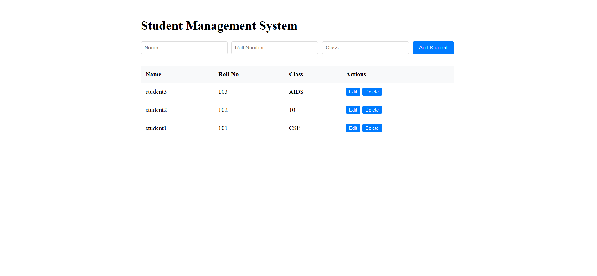

# Student Management System

A full-stack web application built for educational purposes, demonstrating CRUD operations for student record management with modern web technologies.

## 🚀 Tech Stack

- **Frontend**: React.js, CSS3
- **Backend**: Node.js, Express.js
- **Database**: MySQL
- **Architecture**: RESTful API

## ✨ Features

- ✅ Create, read, update, and delete student records
- 📱 Responsive design for all devices
- 🎨 Clean, intuitive user interface
- 👤 Student roll number validation
- 📝 Form validation and error handling
- 🔍 Student list with search functionality
- 📐 Academic Resource Optimization using Linear Programming (see below)

## 🛠️ Installation

### Prerequisites
- Node.js (v14 or higher)
- MySQL Server
- npm or yarn

### Setup

1. **Clone the repository**
   ```bash
   git clone https://github.com/yourusername/student-management-system.git
   cd student-management-system
   ```

2. **Database Setup**
   ```sql
   CREATE DATABASE student_db;
   USE student_db;
   
   CREATE TABLE students (
     id INT AUTO_INCREMENT PRIMARY KEY,
     name VARCHAR(100) NOT NULL,
     roll_no VARCHAR(20) UNIQUE NOT NULL,
     class VARCHAR(20) NOT NULL,
     created_at TIMESTAMP DEFAULT CURRENT_TIMESTAMP
   );
   ```

   
   **Terminal 1 - Backend Server:**
   ```bash
   cd backend
   npm start
   ```
   Backend runs on: http://localhost:5000
   
   **Terminal 2 - Frontend Server:**
   ```bash
   cd frontend
   npm start
   ```
   Frontend runs on: http://localhost:3000

## 📁 Project Structure

```
student-management-system/
├── backend/
│   ├── server.js          # Express server
│   ├── database.sql       # Database schema
│   └── package.json
├── frontend/
│   ├── src/
│   │   ├── App.js         # Main React component
│   │   ├── App.css        # Styling
│   │   └── index.js       # Entry point
│   └── package.json
├── package.json           # Root package for concurrent dev
└── README.md
```

## 🔌 API Endpoints

| Method | Endpoint | Description |
|--------|----------|-------------|
| GET | `/api/students` | Get all students |
| POST | `/api/students` | Create new student |
| PUT | `/api/students/:id` | Update student |
| DELETE | `/api/students/:id` | Delete student |

## 📐 Academic Resource Optimization using Linear Programming (LPP)

Faculty/admins can plan how a student's limited study hours should be split across subjects to maximize expected marks.

### Setup
1. **New database:** `backend/database.sql` already includes the LPP tables (`lpp_problems`, `lpp_subjects`, `lpp_solutions`, `lpp_solution_allocations`).
   **Existing database:** run only `backend/database_lpp.sql` (it does not touch `students`).
2. No new npm packages are required (the simplex solver is self-contained). Start the app as usual (`npm run dev` from the root, or backend and frontend separately).
3. Click **LPP Optimization** in the navigation bar. Optionally pick a student to save and reopen results for that student.
4. Verify the solver: `cd backend && node test_solver.js`.

### Where the code lives
```
backend/lpp/solver.js        Simplex solver (LPP formulation + optimization)
backend/lpp/validation.js    Input validation
backend/routes/lpp.js        REST endpoints
backend/database_lpp.sql     LPP tables
frontend/src/lpp/            LPPOptimization.js (page), lppFormulation.js, lppApi.js, CSS
```

### Mathematical model
| Element | In this project |
|---|---|
| **Decision variables** | `xi` = hours allocated to subject *i* |
| **Objective** | Maximize `Z = c1x1 + … + cnxn`, `ci` = expected marks per hour (× priority if weighting is enabled) |
| **Constraints** | `x1 + … + xn ≤ H` (total hours) and `min_i ≤ xi ≤ max_i` |
| **Optimization** | Simplex method (`backend/lpp/solver.js`): substitute `xi = min_i + yi`, then maximize over `yi ≥ 0` with only `≤` constraints, so the origin is feasible |
| **Optimal solution** | Allocation vector `x*`, maximum `Z`, hours used, remaining hours |
| **Status** | `OPTIMAL`, or `INFEASIBLE` when Σ min_i > H |

Example: Maximize `Z = 8x1 + 6x2 + 10x3` s.t. `x1+x2+x3 ≤ 10`, `2≤x1≤5`, `2≤x2≤5`, `1≤x3≤4` → `x = (4, 2, 4)`, `Z = 84`.

Real-world use: Student → Academic Optimization → LPP Problem → Optimal Study Allocation. Problems can be linked to a student, saved, and reopened from that student's history. The student CRUD features work independently of this module.

### API
| Method | Endpoint | Description |
|---|---|---|
| POST | `/api/lpp/solve` | Validate and solve (not stored) |
| POST | `/api/lpp/save` | Validate, solve and store (optional `studentId`) |
| GET | `/api/lpp/history/:studentId` | Saved problems of a student |
| GET | `/api/lpp/:id` | A saved problem with its solution |

## 🎯 Learning Objectives

This project helps students understand:
- Full-stack development workflow
- RESTful API design principles
- Database integration with MySQL
- React component architecture
- CRUD operations implementation
- Frontend-backend communication

## 📸 Screenshots


## 🤝 Contributing

1. Fork the repository
2. Create your feature branch (`git checkout -b feature/AmazingFeature`)
3. Commit your changes (`git commit -m 'Add some AmazingFeature'`)
4. Push to the branch (`git push origin feature/AmazingFeature`)
5. Open a Pull Request


## 👨‍💻 Author

Created for educational purposes to demonstrate modern web development practices.

**Contact:** info@virustechsolutions.com  
**Project Link:** https://github.com/virus-tech-solutions/student-management-system
